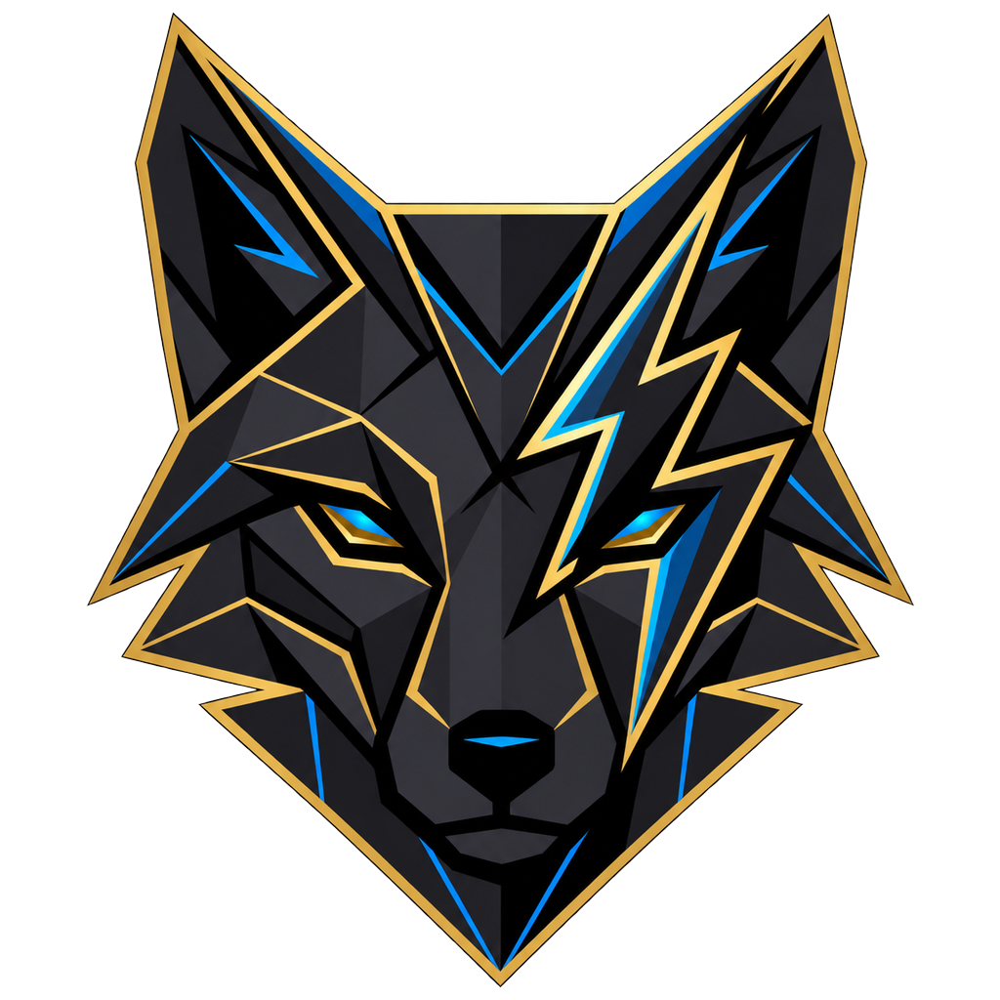

  

<h1 align="center">NEXUS</h1>

<strong>Agente de IA y estudio creativo para Android, con aplicación de escritorio para Windows.</strong>

Conversación · Imagen · Vídeo · Audio · Edición

Un proyecto de <a href="https://www.linkedin.com/in/vidal-dominguez-rodriguez/">Vidal Domínguez Rodríguez</a>

Nexus conecta conversación, generación multimedia, guion y edición de vídeo en un
mismo espacio de trabajo. Las ideas, las referencias, los archivos y el montaje
forman parte del mismo proyecto.

## Del proyecto al resultado

| Espacio | Qué aporta |
|---|---|
| **Agente** | Conversación con adjuntos y herramientas para trabajar con proyectos y materiales. |
| **ArtBox** | Selección de modelos y proveedores para crear imágenes, vídeo y audio con texto o referencias, según el modelo. |
| **Guion** | Organización de escenas, planos, personajes, storyboard y referencias. |
| **Nexus Cut** | Edición multipista, recorte y reordenación de clips, previsualización y exportación, con asistencia del agente. |
| **Biblioteca** | Archivo de materiales importados y generados para encontrarlos y reutilizarlos. |

## Decisiones de producto

**Contexto compartido.** El agente y las herramientas visuales trabajan sobre los
mismos proyectos.

**Continuidad creativa.** Guion, referencias y material audiovisual se conectan
con el editor y la biblioteca.

**Elección de modelos.** Las opciones de generación se adaptan al modelo y al
proveedor elegidos.

**Interacción directa y asistida.** Las herramientas visuales y el agente ofrecen
formas complementarias de trabajar.

## Tecnología

Android está desarrollado en **Kotlin y Jetpack Compose**, con núcleos Kotlin
separados para el agente y la edición. **Nexus Desktop para Windows** combina
un host Python, una interfaz web y un agente JVM.

Las funciones disponibles pueden variar entre plataformas y versiones.

## Disponibilidad

**Nexus está en desarrollo y todavía no está disponible para descarga pública.**

Este repositorio es la presentación del producto. El código fuente y las
versiones de desarrollo se mantienen en privado.

## Autor

**Vidal Domínguez Rodríguez** — concepto de producto, diseño de experiencia,
desarrollo Android y Windows e integración de servicios de IA.

Para conocer el proyecto o hablar de colaboraciones:

[LinkedIn](https://www.linkedin.com/in/vidal-dominguez-rodriguez/) ·
[GitHub](https://github.com/egodivergente)
