# Galería completa de Nexus

[← Volver a la presentación](../README.md) · [Abrir el escaparate visual](https://egodivergente.github.io/nexus-showcase/)

Las **17 capturas originales** de la aplicación Android, tomadas el **26 de noviembre de 2026**.
Abre una sección y pulsa cualquier captura para verla completa.

<strong>01 · Agente y conversación</strong>

<table>
  <tr>
    <th align="center">Tu espacio creativo</th>
    <th align="center">Actividad del agente</th>
  </tr>
  <tr>
    <td align="center"></td>
    <td align="center"><a href="../assets/screenshots/agente-actividad.jpg">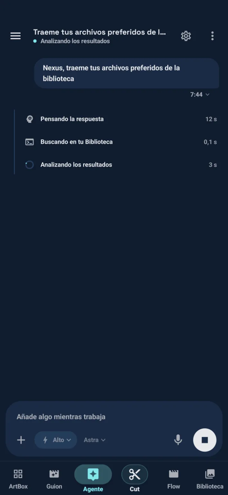</a></td>
  </tr>
  <tr>
    <td>Inicio de una conversación con propuestas para crear.</td>
    <td>Seguimiento de la búsqueda de materiales y el análisis de resultados.</td>
  </tr>
  <tr>
    <th align="center">Resultados visuales</th>
    <th align="center">Preparar una generación</th>
  </tr>
  <tr>
    <td align="center"></td>
    <td align="center"><a href="../assets/screenshots/agente-generacion.jpg">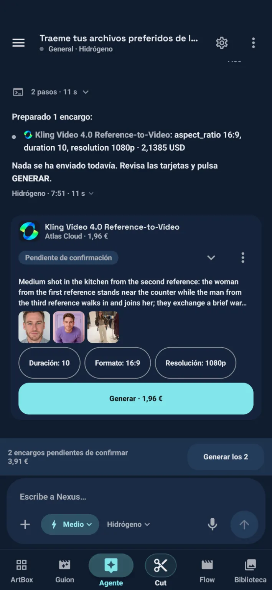</a></td>
  </tr>
  <tr>
    <td>Materiales de la biblioteca presentados junto a la respuesta.</td>
    <td>Una propuesta con referencias y parámetros lista para revisar.</td>
  </tr>
</table>

<strong>02 · ArtBox y generación</strong>

<table>
  <tr>
    <th align="center">ArtBox · Vídeo</th>
    <th align="center">ArtBox · Imagen</th>
  </tr>
  <tr>
    <td align="center"><a href="../assets/screenshots/artbox-video.jpg">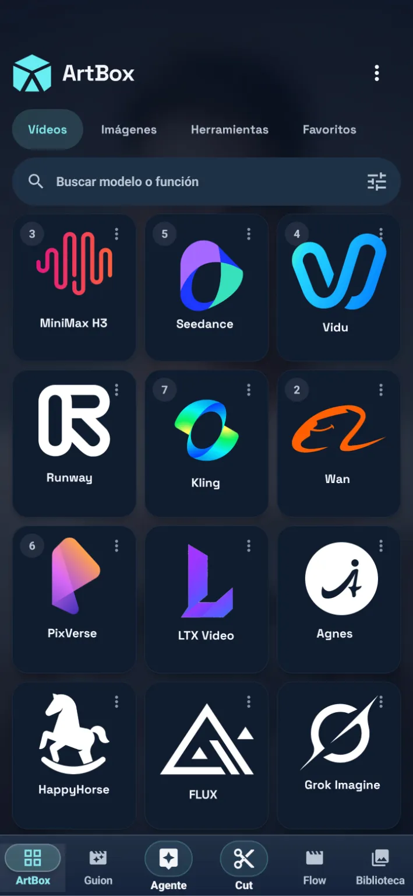</a></td>
    <td align="center"><a href="../assets/screenshots/artbox-imagen.jpg">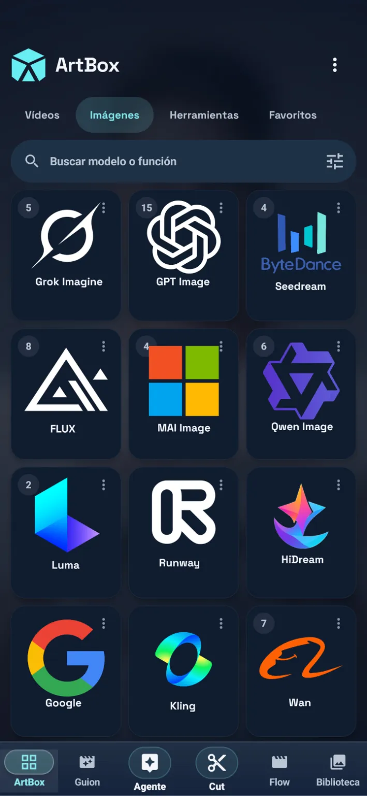</a></td>
  </tr>
  <tr>
    <td>Catálogo de familias de modelos de vídeo.</td>
    <td>Catálogo de familias de modelos de imagen.</td>
  </tr>
  <tr>
    <th align="center">Generación de imágenes</th>
    <th align="center">Generación de vídeo</th>
  </tr>
  <tr>
    <td align="center"><a href="../assets/screenshots/generacion-imagen.jpg">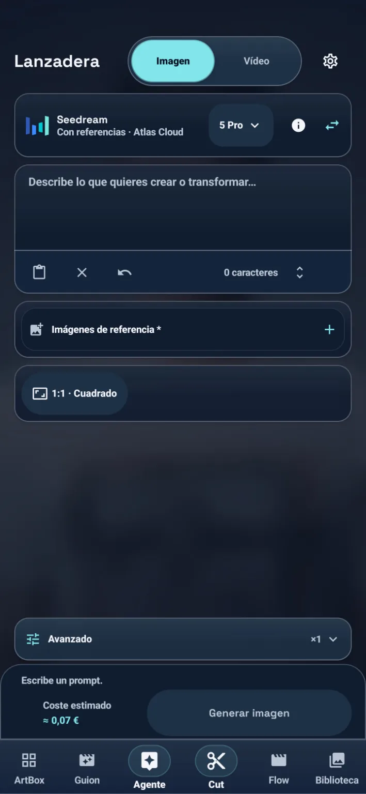</a></td>
    <td align="center"></td>
  </tr>
  <tr>
    <td>Prompt, referencias y opciones del modelo elegido.</td>
    <td>Referencias, duración, resolución y audio.</td>
  </tr>
</table>

<strong>03 · Guion y referencias</strong>

<table>
  <tr>
    <th align="center">Material del proyecto</th>
    <th align="center">Referencias a la vista</th>
  </tr>
  <tr>
    <td align="center"><a href="../assets/screenshots/guion-material.jpg">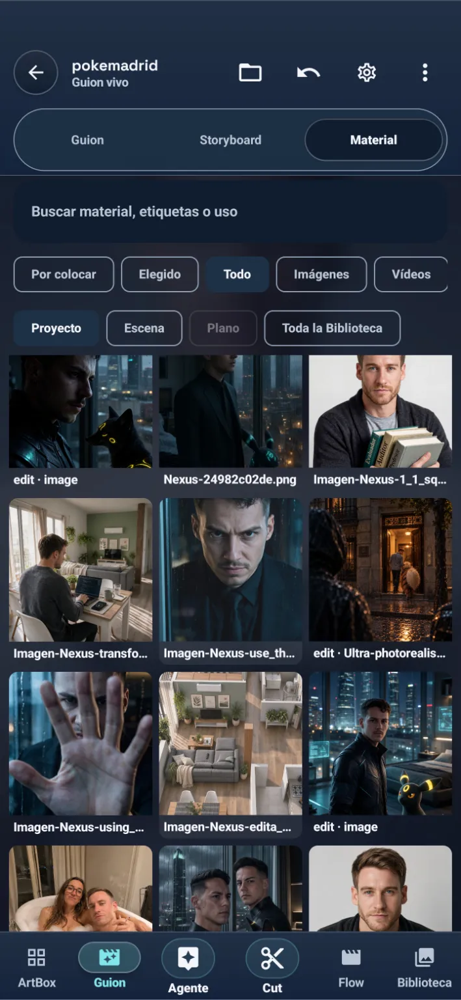</a></td>
    <td align="center"><a href="../assets/screenshots/visor-referencias.jpg">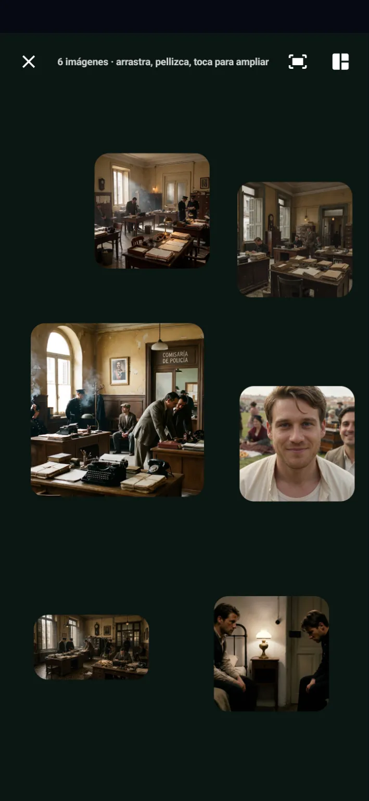</a></td>
  </tr>
  <tr>
    <td>Búsqueda y organización de imágenes y vídeos desde Guion.</td>
    <td>Visor de varias imágenes con movimiento y ampliación.</td>
  </tr>
</table>

<strong>04 · Nexus Cut</strong>

<table>
  <tr>
    <th align="center">Tus montajes</th>
    <th align="center">Línea de tiempo</th>
  </tr>
  <tr>
    <td align="center"><a href="../assets/screenshots/cut-proyectos.jpg">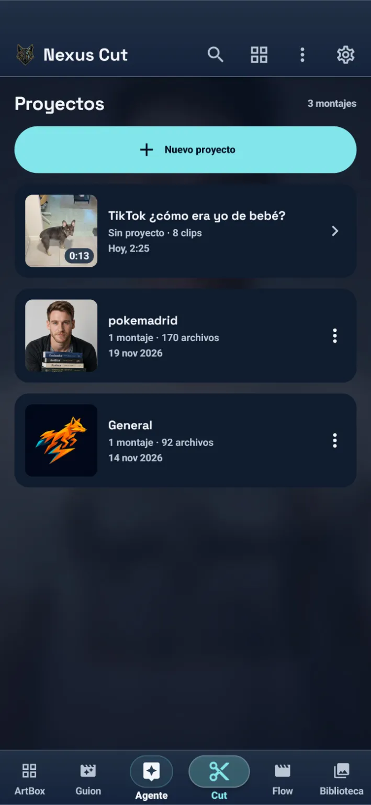</a></td>
    <td align="center"><a href="../assets/screenshots/cut-timeline.jpg">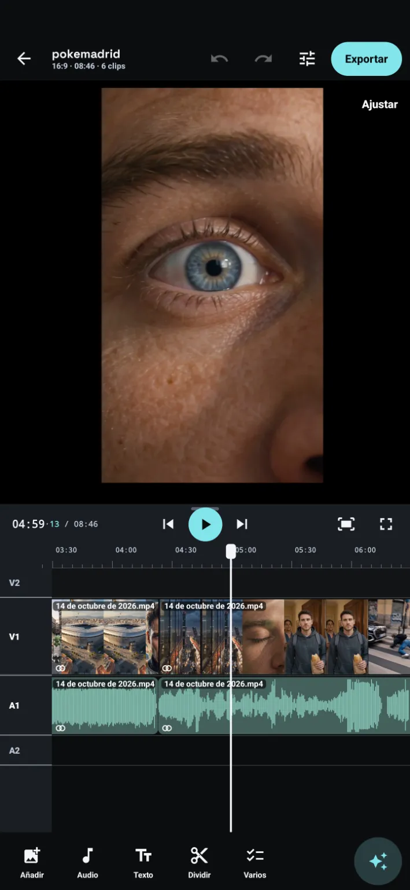</a></td>
  </tr>
  <tr>
    <td>Listado de proyectos y acceso al editor.</td>
    <td>Previsualización, pistas de vídeo y audio y herramientas de edición.</td>
  </tr>
  <tr>
    <th align="center">El agente en el editor</th>
  </tr>
  <tr>
    <td align="center"></td>
  </tr>
  <tr>
    <td>Asistencia dentro del montaje, junto a la línea de tiempo.</td>
  </tr>
</table>

<strong>05 · Flow integrado</strong>

<table>
  <tr>
    <th align="center">Proyectos de Flow</th>
    <th align="center">Un proyecto abierto</th>
  </tr>
  <tr>
    <td align="center"><a href="../assets/screenshots/flow-biblioteca.jpg">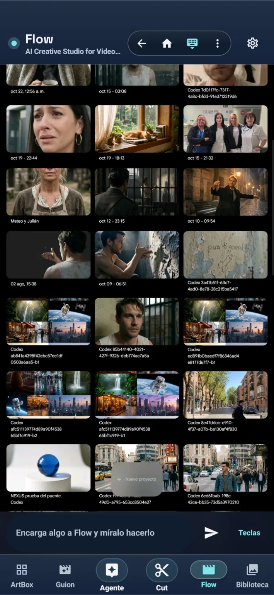</a></td>
    <td align="center"></td>
  </tr>
  <tr>
    <td>Vista integrada de la biblioteca de proyectos de Google Flow.</td>
    <td>Materiales audiovisuales de un proyecto de Google Flow desde Nexus.</td>
  </tr>
</table>

<strong>06 · Biblioteca y ajustes</strong>

<table>
  <tr>
    <th align="center">Biblioteca de vídeos</th>
    <th align="center">Ajustes de Nexus</th>
  </tr>
  <tr>
    <td align="center"><a href="../assets/screenshots/biblioteca-video.jpg">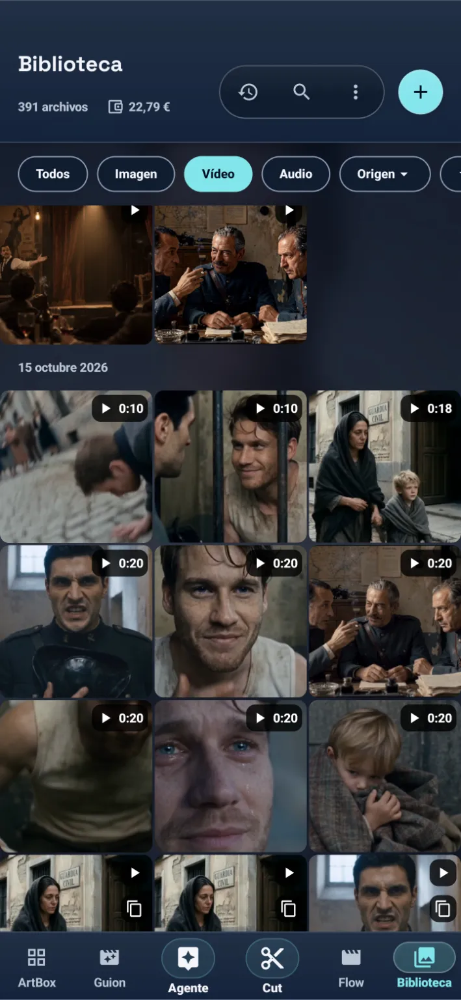</a></td>
    <td align="center"><a href="../assets/screenshots/ajustes.jpg">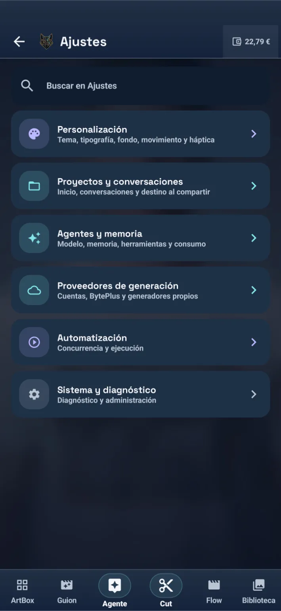</a></td>
  </tr>
  <tr>
    <td>Materiales organizados con filtros y miniaturas.</td>
    <td>Personalización, agentes, proveedores y opciones de la aplicación.</td>
  </tr>
</table>

Las capturas corresponden a una versión de desarrollo. Los modelos, las opciones
y la interfaz pueden variar entre versiones.

**Nexus todavía no está disponible para descarga pública.**

[Conocer al creador en LinkedIn](https://www.linkedin.com/in/vidal-dominguez-rodriguez/)
