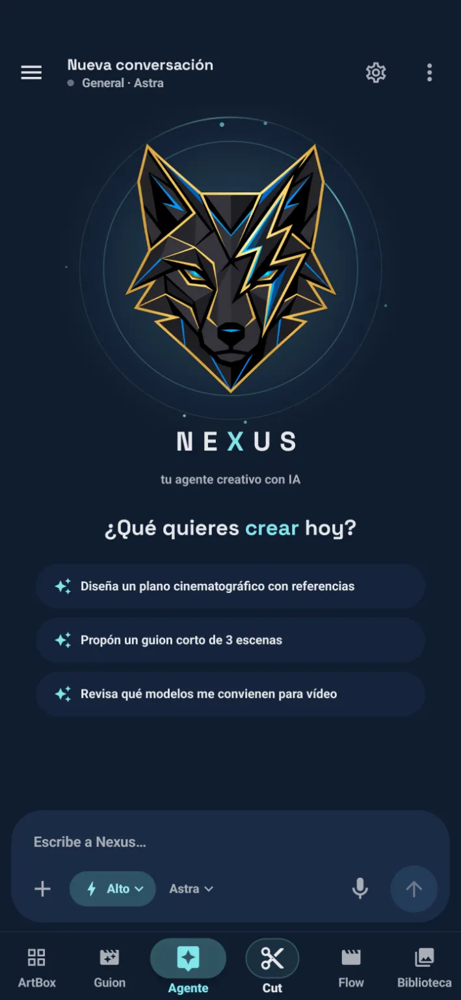
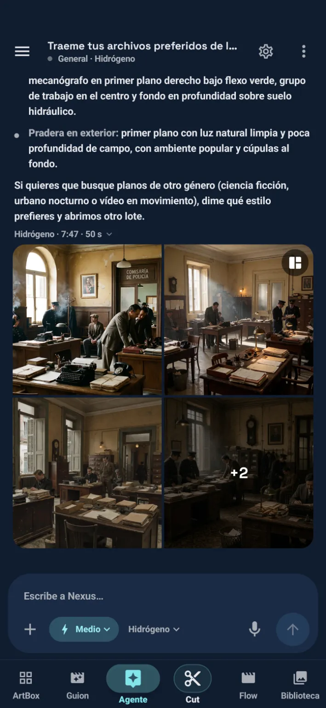
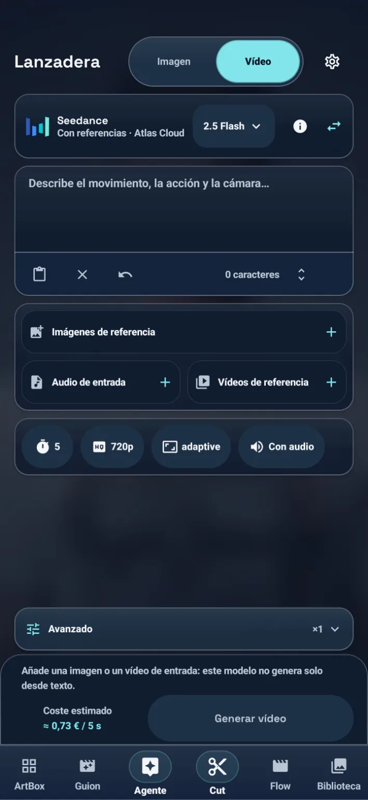
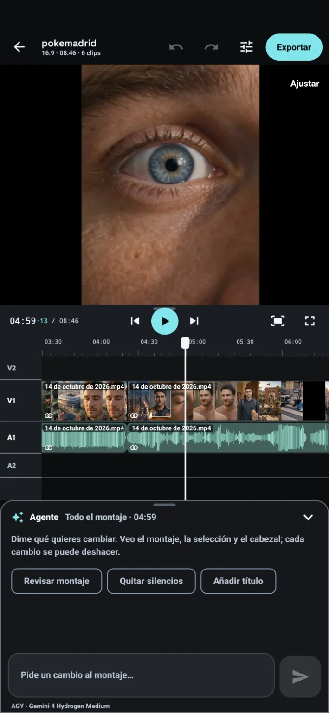
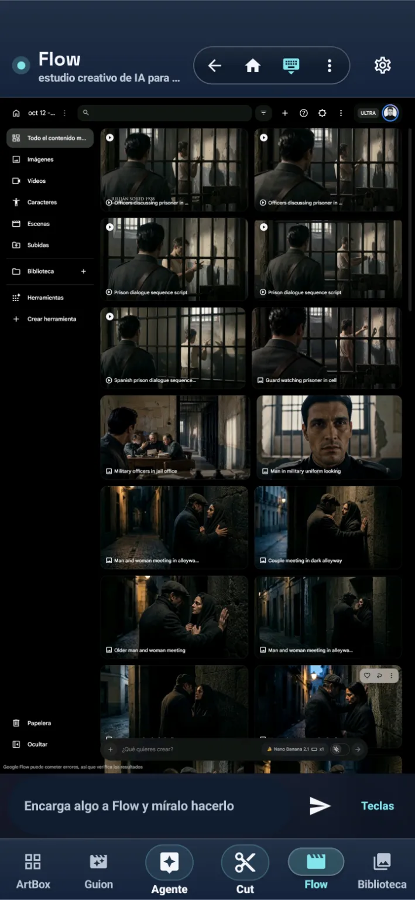

# Nexus en uso

[← Volver a la presentación](../README.md)

Ocho capturas reales de la aplicación Android, tomadas el **26 de noviembre de 2026**.
Cada imagen se puede abrir para verla con más detalle.

## 1. Conversar y encontrar materiales

<table>
  <tr>
    <th align="center">Tu espacio creativo</th>
    <th align="center">Resultados en la conversación</th>
  </tr>
  <tr>
    <td align="center"></td>
    <td align="center"></td>
  </tr>
  <tr>
    <td>Inicia una conversación, elige el agente y plantea lo que quieres crear.</td>
    <td>El agente encuentra materiales de la biblioteca y los presenta junto a su respuesta.</td>
  </tr>
</table>

## 2. Elegir los modelos

<table>
  <tr>
    <th align="center">ArtBox · Vídeo</th>
    <th align="center">ArtBox · Imagen</th>
  </tr>
  <tr>
    <td align="center"></td>
    <td align="center"></td>
  </tr>
  <tr>
    <td>Explora familias de modelos de vídeo desde un catálogo común.</td>
    <td>Encuentra las opciones de generación de imágenes en el mismo espacio.</td>
  </tr>
</table>

## 3. Preparar la creación

<table>
  <tr>
    <th align="center">Configurar la generación</th>
    <th align="center">Referencias a la vista</th>
  </tr>
  <tr>
    <td align="center"></td>
    <td align="center"></td>
  </tr>
  <tr>
    <td>Configura referencias, duración, resolución y audio según las opciones del modelo.</td>
    <td>Reúne varias imágenes en un visor donde puedes moverlas y ampliarlas.</td>
  </tr>
</table>

## 4. Montar y trabajar con Flow

<table>
  <tr>
    <th align="center">Nexus Cut · Edición con agente</th>
    <th align="center">Flow integrado</th>
  </tr>
  <tr>
    <td align="center"></td>
    <td align="center"></td>
  </tr>
  <tr>
    <td>Trabaja sobre la línea de tiempo y pide cambios al agente desde el mismo editor.</td>
    <td>Consulta un proyecto de Google Flow y sus materiales desde Nexus.</td>
  </tr>
</table>

Las capturas corresponden a una versión de desarrollo. Los modelos, las opciones
y la interfaz pueden variar entre versiones.

**Nexus todavía no está disponible para descarga pública.**

[Conocer al creador en LinkedIn](https://www.linkedin.com/in/vidal-dominguez-rodriguez/) ·
[Volver a la presentación](../README.md)
